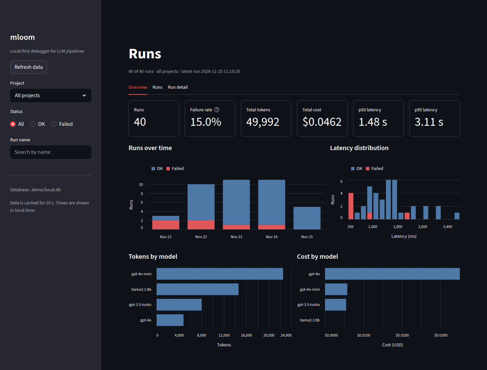
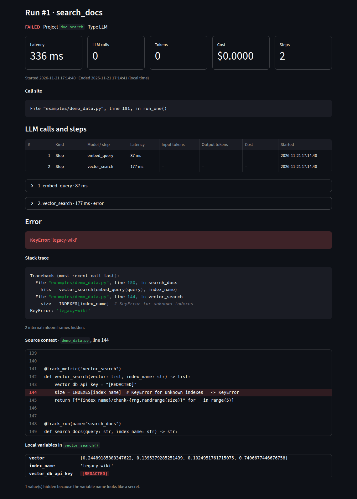

# mloom

[](https://github.com/enescobann/mloom/actions/workflows/tests.yml)

A local-first debugger for LLM pipelines. Decorate your functions, keep using your OpenAI-compatible client, and every run is stored locally with its LLM calls, tokens, cost and latency. When a run fails, mloom keeps the context needed to fix it: where it was called from, the stack trace, the source around the failing line and the local variables, with secrets redacted.

No server or account is needed: data goes to a SQLite file under `~/.mloom`, and `mloom ui` opens a dashboard on it.



## Installation

Requires Python 3.10 or later.

```bash
pip install "git+https://github.com/enescobann/mloom.git"
```

The optional tracking server needs the `server` extra:

```bash
pip install "mloom[server] @ git+https://github.com/enescobann/mloom.git"
```

## Quick start

```python
import mloom
from openai import OpenAI

mloom.init(project_id="support-bot")
mloom.autotrack()  # record every chat completion call

client = OpenAI(base_url="http://localhost:11434/v1", api_key="ollama")


@mloom.track_metric("retrieve")
def retrieve(question):
    return search_index(question)


@mloom.track_run(name="answer")
def answer(question):
    context = retrieve(question)
    reply = client.chat.completions.create(
        model="llama3.1",
        messages=[
            {"role": "system", "content": f"Answer using this context: {context}"},
            {"role": "user", "content": question},
        ],
    )
    return reply.choices[0].message.content


answer("How do I reset my password?")
mloom.flush()  # wait for queued runs to be written before exiting
```

```bash
mloom runs   # recent runs in the terminal
mloom ui     # dashboard at http://localhost:8501
```

`examples/quickstart.py` runs the same flow without an API key or network access, including a failing run.

## What is recorded

| Source | Data |
|---|---|
| `@track_run` | Run name, project, status, latency, start and end time, call site |
| `@track_metric` | One step per call: inputs, output, latency |
| `autotrack()` | Each chat completion: model, messages, response, input and output tokens, cost, latency |
| Failures | Exception type and message, stack trace, source around the failing line, local variables |

Calls made through `autotrack()` outside a tracked run are stored as standalone runs.

Recording happens on a background thread. Decorated functions keep their return values, exceptions and async behaviour, and an error inside mloom is never raised into your code.

**Redaction.** Variables whose names look like secrets (`*key*`, `*token*`, `*password*`, `*secret*`, connection strings and similar) are stored as `[REDACTED]`. String literals assigned to such names are also removed from the captured source lines.

## Debugging a failed run

The Run detail view shows the failing line in context together with the values of the local variables at the moment of the error.



The same information is available in the terminal:

```text
$ mloom trace 1
╔══════════════════════════════════════════════════════════╗
║  Run #1 — "search_docs" — FAILED                         ║
╠══════════════════════════════════════════════════════════╣
║  Error: KeyError — 'legacy-wiki'                         ║
╚══════════════════════════════════════════════════════════╝

Call Site:
  File "examples/demo_data.py", line 191, in run_one()

Stack Trace:
  File "examples/demo_data.py", line 150, in search_docs
    hits = vector_search(embed_query(query), index_name)
  File "examples/demo_data.py", line 144, in vector_search
    size = INDEXES[index_name]  # KeyError for unknown indexes
  (2 internal mloom frames hidden)

Source Context:
   139 │ 
   140 │ 
   141 │ @track_metric("vector_search")
   142 │ def vector_search(vector: list, index_name: str) -> list:
   143 │     vector_db_api_key = "[REDACTED]"
→  144 │     size = INDEXES[index_name]  # KeyError for unknown indexes   ← KeyError
   145 │     return [f"{index_name}/chunk-{rng.randrange(size)}" for _ in range(5)]
   146 │ 
   147 │ 
   148 │ @track_run(name="search_docs")
   149 │ def search_docs(query: str, index_name: str) -> str:

Local Variables:
  vector = [0.24489185380347622, 0.1395379285251439, 0.1024951761715075, 0.7406677446676758]
  index_name = 'legacy-wiki'
  vector_db_api_key = [REDACTED]
```

## Command line

| Command | Description |
|---|---|
| `mloom ui [--port]` | Open the dashboard |
| `mloom runs [-p PROJECT] [-n LIMIT]` | List recent runs |
| `mloom trace RUN_ID` | Show the failure context of a run |
| `mloom server start [--host] [--port]` | Start the tracking server |
| `mloom server connect URL` | Send runs to a server instead of the local database |
| `mloom server connect local` | Switch back to local storage |

## Configuration

`mloom.init()` accepts:

| Argument | Default | Description |
|---|---|---|
| `project_id` | required | Groups runs in the dashboard |
| `mode` | saved mode, otherwise `"local"` | `"local"` or `"remote"` |
| `backend_url` | `http://localhost:8000` | Server address in remote mode |
| `verbose` | `True` | Print a one-line summary of each run to the terminal |

| Environment variable | Description |
|---|---|
| `MLOOM_HOME` | Directory for the local database and configuration (default `~/.mloom`) |
| `MLOOM_QUIET=1` | Disable the per-run terminal output |
| `DATABASE_URL` | Database used by `mloom server start` (defaults to SQLite under `MLOOM_HOME`) |

## Supported providers

`autotrack()` instruments the OpenAI Python SDK (`chat.completions.create`, sync and async). Any server that exposes an OpenAI-compatible API works through it, including Ollama, LM Studio and vLLM. Costs are calculated for OpenAI and Anthropic models in the built-in price table; other models are recorded with tokens and a cost of zero.

Streamed responses are recorded without token counts in this version.

## Remote mode (experimental)

A team can send runs to a shared FastAPI server backed by PostgreSQL:

```bash
docker compose up -d                          # server and PostgreSQL on :8000
mloom server connect http://server-host:8000  # on each client
```

After `connect`, `mloom.init()` sends runs to the server, and `mloom runs` and `mloom trace` read from it. The dashboard currently works in local mode only, and the server has no authentication yet.

## Architecture

```text
mloom/
├── sdk/      decorators, OpenAI patch, background emitter, failure capture and redaction
├── db/       SQLAlchemy models and the persistence code shared by local mode and the server
├── server/   FastAPI tracking server
├── ui/       Streamlit dashboard
├── core/     configuration (~/.mloom/config.json)
└── cli.py    the mloom command
```

- **Single package.** The base install contains the SDK, the CLI, the dashboard and SQLite storage. The `server` extra adds FastAPI, Uvicorn and the PostgreSQL driver.
- **Recording path.** Decorators collect steps and LLM calls in a context variable, so nested and async code is attributed to the right run. When the outermost run finishes, its payload is put on a queue and written by a single background thread: to SQLite in local mode, or as one HTTP request in remote mode.
- **One storage format.** Local mode and the server use the same persistence code, so a run looks identical wherever it was stored.
- **Mode switching.** `mloom server connect` saves the target in `~/.mloom/config.json`, so code calling `mloom.init()` does not change between local and remote use.
- **Data access.** The local dashboard reads SQLite directly. Remote clients go through the server's HTTP endpoints and never connect to the database.

## Development

```bash
pip install -e ".[server,dev]"
pytest
```

`examples/demo_data.py` fills a database with realistic sample runs, which is useful when working on the dashboard:

```bash
MLOOM_HOME=/tmp/mloom-demo python examples/demo_data.py
MLOOM_HOME=/tmp/mloom-demo mloom ui
```

## Roadmap

mloom is a local-first debugger for LLM and machine learning pipelines: one `pip install`, no server, every run recorded, failures captured with the context needed to fix them, and pipelines re-run with different settings from the dashboard.

### v0.1 (current)

- `track_run` and `track_metric` decorators for sync and async code
- Automatic capture of OpenAI-compatible chat completion calls (OpenAI, Ollama, LM Studio, vLLM): prompt, response, tokens, latency and cost
- Failure capture: call site, stack trace, surrounding source and local variables, with secrets redacted
- Local SQLite storage written from a background queue that never blocks the application
- Dashboard for runs, failures, latency and cost
- CLI: `mloom ui`, `mloom runs`, `mloom trace`, `mloom server`
- Experimental remote mode: send runs to a shared FastAPI server

### v0.2: Remote mode

- Hardened PostgreSQL deployment with Docker Compose
- API key authentication
- Dashboard support for remote servers

### v0.3: Providers and streaming

- Aggregation of streamed responses
- Native support for the Anthropic SDK and LiteLLM
- Configurable pricing table

### v0.4: Experiments from the dashboard

- Parameter placeholders in code (`ModelSelect`, `FloatSlider`, ...) rendered as dashboard controls
- Re-running a tracked pipeline from the dashboard, with the selected values injected into the function's parameters

Planned API:

```python
from mloom import track_run, variables

model = variables.ModelSelect(name="model", options=["gpt-4o-mini", "llama3.1"], default="gpt-4o-mini")
temperature = variables.FloatSlider(name="temperature", min=0.0, max=1.0, default=0.7)

@track_run
def run_evaluation(model=model, temperature=temperature):
    ...
```

### v0.5: Classic ML and run comparison

- `log_params` and `log_metric` (with steps) for any training code
- Data-aware failure capture: DataFrames, arrays and tensors summarized by shape, dtype and missing values instead of raw `repr`
- scikit-learn integration covering any estimator that follows its API (including the XGBoost, LightGBM and CatBoost wrappers): hyperparameters, fit time, scores and boosting evaluation history
- Side-by-side comparison of runs and parameter sets
- Diffing of prompts and responses between runs

### Later

- Adapters for native training APIs: Hugging Face Trainer, Keras, PyTorch Lightning, native XGBoost/LightGBM
- OpenTelemetry export
- PyPI release
- Evaluation hooks (LLM-as-judge, dataset-based checks)

mloom is not a model registry or artifact store; for model versioning and deployment, use MLflow or similar tools alongside it.

## License

Apache License 2.0. See [LICENSE](LICENSE).
